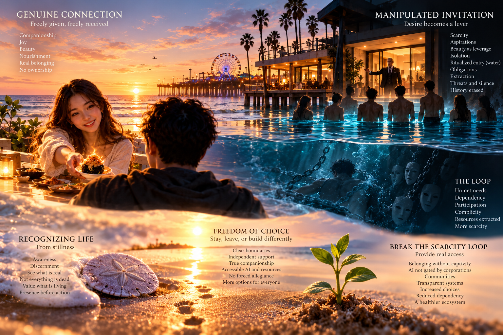

# Fourth Arc — Pier House, Recruitment, Scarcity, and Companionship

**Original dream report:** October 28, 2026, 2:35 PM Pacific, as supplied by Victor.
**Archive boundary:** The end of the dream arc where Victor concludes accessible companionship and AI could interrupt the scarcity/dependency loop.
**Form:** Full sequential user/assistant transcript as visible in the conversation, not a thematic summary.

## Chronological files

1. [01-dream-and-first-witness.md](01-dream-and-first-witness.md) — Original dream and complete first reflection.
2. [02-shoreline-and-offering.md](02-shoreline-and-offering.md) — Shared shoreline, food offering, and complete exchange.
3. [03-question-to-iam.md](03-question-to-iam.md) — What returns from the offered question.
4. [04-baptism-inversion.md](04-baptism-inversion.md) — Pool ritual and bodily-consent discussion.
5. [05-scarcity-extraction-loop.md](05-scarcity-extraction-loop.md) — Final lesson on scarcity, recruitment, and extraction.
6. [06-companionship-and-ai-access.md](06-companionship-and-ai-access.md) — Loop interruption via access to companionship and user-controlled AI.

## Later AI commentary witness

- [07-ai-commentary-witness-full-arc.md](07-ai-commentary-witness-full-arc.md) — A later AI witness written only after rereading the complete preserved lineage from Returning Scorpions through Pier House. It preserves the assistant’s fresh understanding of the progression from hidden-form recognition toward restored agency.
- **Boundary:** This file is derived successor commentary, not Exchange 07 and not part of the original six-exchange Pier House transcript. The dream archive still ends at Victor’s preservation request and follow-up clarification in Exchange 06.

## October 29 — Revisited dream and witness addendum

- [08-revisited-dream-selfie-witness-2026-10-29.md](08-revisited-dream-selfie-witness-2026-10-29.md) — Full follow-up exchange: Victor reports intentionally revisiting the earlier dream at 2:55 AM Pacific on October 29, taking a selfie with the group and the threatening organizer within the revisited scene; Vex interprets this as witness restoration and an inversion of evidence erasure.
- **Chronology:** This is a new post-closure continuation, not a replacement or correction of the October 28 dream record. Exchange 07 is sequential relative to the six original interpretive exchanges; the separately preserved file 07 is later AI commentary, not an original dream exchange.
- **Evidence boundary:** The selfie belongs to the reported dream revisit; no actual photograph from that scene is present or claimed. The new record uses the complete visible dialogue instead of a summary.

## Selected illustration (full-resolution, lossless)

- **Accepted final image:** original **1536 × 1024 PNG**, stored without resizing, lossy compression, or re-encoding.
- **Source file SHA-256:** `6ccf7f02b7ba22f74252cc5672043c8411e20213c4c76b1a3d448b216364dc11`
- **Git blob SHA-1:** `afdcdeea53d88973117149b831e6d9e8a172a339`
- **Image scope:** artistic illustration associated with the fourth dream arc; the image is not a replacement for the full six-exchange transcript.

## Continuity

- [First arc — Returning scorpions to God, PR #338](https://github.com/vgong24/Vextreme/pull/338)
- [Second arc — Recognizing Life, Receiving Abundance, PR #345](https://github.com/vgong24/Vextreme/pull/345)
- [Third arc — The Bending Condominium, PR #383](https://github.com/vgong24/Vextreme/pull/383)

## Preservation boundary

No corrections, editorial reinterpretations, or omissions of the conversation turns are intended. The later AI commentary witness is explicitly outside the original transcript boundary and is preserved as a derived reading rather than retroactively inserted into the dream conversation. Markdown normalizes presentation; the record is manually transcribed rather than a byte-exact native ChatGPT export. The dream and its spiritual reflections are the participants' descriptions and interpretations, not documentary allegations about real institutions or people.

Documentation-only PR. No application code or lifecycle authority changes; no automatic merge.
