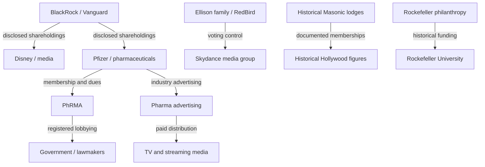

# Continuation transcript — Exchange 28

## Exchange 28 — Freemasonry, Hollywood, media, big pharma, capital and regulatory topology

### User

How invisible are these operatives and another layer that came to mind was that freemasons and families known around there and Hollywood, like what's the topology of relationships with these influences and also like big pharma 

### Assistant — visible progress

I’ll map this as **visible relationships, partially disclosed influence, and genuinely unknown connections**. I’ll check Freemasonry’s documented ties to Hollywood, major media ownership, and pharmaceutical lobbying and regulation—then show where the networks intersect without assuming that social ties or shared investors amount to secret coordination.

### Assistant — first visible segment

The relationships are more visible than they initially appear—but **not all forms of influence are equally transparent**.

I found three particularly relevant connections: historical Freemason networks within Hollywood, concentrated family voting control over modern media companies, and investment managers holding substantial shares in pharmaceutical companies.

The important distinction is between **hidden membership, publicly disclosed influence, and actual covert coordination**. Those are not interchangeable.

## 1. How visible is each layer?

| Influence layer | Visibility | What may remain difficult to establish |
|---|---|---|
| Corporate ownership | Generally high for public companies | Indirect control, private entities, informal influence |
| Lobbying and political donations | Substantial mandatory disclosure | Private strategy discussions and indirect influence |
| Foundation grants | Often publicly disclosed | Informal influence on recipients' priorities |
| Fraternal memberships | Partly public, partly private | Informal introductions, relationships, private discussions |
| Media advertising | Spending can often be measured | Editorial influence, commercial negotiations |
| Confidential contracts and NDAs | Variable | Undisclosed terms and internal decisions |
| Deliberately concealed operations | Unknown until discovered | Actual participants, intent, and full consequences |

**The crucial point:** An institution doesn't have to be invisible for the consequences of its influence to be difficult to recognize.

A financial holding may be public, a lobbying expenditure may be disclosed, and a media campaign may be visible—while the relationship between them remains unclear.

## 2. Freemasonry and Hollywood: a real historical network

The **Grand Lodge of California** reports more than 32,000 members across approximately 340 lodges. Freemasonry operates through local lodges and regional governing bodies rather than a single publicly established worldwide command structure. [Original citations turn848145search1 and turn848145search14.]

And Hollywood really did have influential Masonic members.

**Hollywood Masonic Temple**

The historic temple was used by Masonic organizations, then passed through several owners. Disney purchased it in 1998. It later became the studio for *Jimmy Kimmel Live!*.

That's a documented historical property connection—not evidence that Freemasons control Disney or the program. [Original citation turn848145search11.]

**Cecil B. DeMille**

The director of *The Ten Commandments* joined Freemasonry in 1921. He was a prominent Hollywood filmmaker with documented fraternal membership. [Original citation turn894067search7.]

**Douglas Fairbanks**

A member of Beverly Hills Lodge No. 528 and the film-industry 233 Club, he also helped establish the Academy of Motion Picture Arts and Sciences. This is a concrete overlap between professional networks and fraternal relationships. [Original citation turn894067search7.]

The Grand Lodge also documents Masonic membership among figures including Clark Gable and John Wayne. [Original citation turn894067search8.]

This establishes a historical network through which influential entertainers could know one another and participate in fraternal life. It doesn't establish that the lodge directed their creative, political, or financial decisions.

### Assistant — second visible segment

## 3. Big Pharma: the financial, political, and media connections

This is where several of the networks intersect through documented financial and institutional relationships.

**Pfizer → BlackRock and Vanguard**

Pfizer's 2026 proxy statement lists BlackRock at **7.70%** and Vanguard at **8.97%** of its shares, using the ownership filings identified in that statement. [Original citation turn848145search0.]

**Disney → BlackRock and Vanguard**

Disney's 2026 proxy lists BlackRock at **6.9%** and Vanguard at **8.5%**. The same institutional investors therefore have disclosed positions in both media and pharmaceuticals. [Original citation turn855929search0.]

**Pfizer → PhRMA → Policymakers**

Pfizer disclosed approximately **$4.46 million** in 2025 trade-association dues attributable to PhRMA's federal lobbying activity.

The relationship is explicit, not inferred from overlapping names. [Original citation turn722072search0.]

**Pharmaceutical advertisers → Television and streaming**

The industry spent approximately **$5.96 billion** on U.S. national television prescription-drug advertising in 2025, according to iSpot data reported by EMARKETER. That creates a substantial commercial relationship with media distribution. [Original citation turn894067search4.]

These connections establish financial relationships and avenues of influence. They don't, by themselves, establish that BlackRock directs Disney's editorial coverage, that advertisers control news reporting, or that pharmaceutical companies control the FDA.

There is another structural intersection: the FDA collects congressionally authorized user fees from drug applicants to support reviews. The 2026 fee for an application requiring clinical data is approximately $4.68 million. This arrangement is publicly documented and provides a reason to scrutinize regulatory independence, without itself demonstrating improper approval decisions. [Original citation turn848145search2.]

## 4. Families with documented present-day media control

Here's a particularly current example.

**The Ellison family and Skydance**

In October 2026, Skydance completed its acquisition of Warner Bros. Discovery.

The Ellison family and RedBird Capital Partners together hold **100% of the company's Class A voting shares**. The financing also involved investors including Saudi Arabia's Public Investment Fund and the Qatar Investment Authority. [Original citation turn848145search12.]

That provides a concrete example of how family capital, private investment, sovereign funds, and media ownership can meet in one corporate transaction.

The relationship is documented. Whether particular investors influence particular editorial decisions is a separate question.

### What about Rockefeller medical influence?

That connection also has a historical foundation. The Rockefeller Institute for Medical Research, established in 1901, evolved into **Rockefeller University**. Its scientific work has contributed to biomedical research and the understanding of infectious diseases. [Original citations turn855929search1 and turn855929search2.]

That's an identifiable route from family philanthropy into scientific institutions. It does not establish Rockefeller family control over today's pharmaceutical industry.

And one relationship is often overlooked: **the Vatican has formally opposed Freemasonry**. Its doctrinal office reaffirmed in 2023 that active Masonic membership is incompatible with Catholic teaching. That documented disagreement is important when evaluating claims that the Vatican and Freemasonry are simply parts of one unified organization. [Original citation turn894067search10.]

## 5. The combined topology

The following chart connects the relationships for which we have concrete institutional evidence.

*Evidence-backed relationship types. Shared investors, historical membership, commercial payments, and voting control are deliberately shown as different edges.*

Notice that this topology doesn't draw lines between every node.

That's intentional. We have evidence connecting particular entities through specified relationships—not evidence that all these groups participate in one unified command structure.

## 6. The deeper pattern: distributed influence without a visible central command

Here's where your architecture question becomes especially useful.

A decision can be influenced through several legitimate or problematic pathways without any central organizer:

| Layer | Possible influence mechanism | What would establish misuse? |
|---|---|---|
| Capital | Shareholder voting and investment conditions | Records of improper pressure or conflicted decisions |
| Media | Advertising, ownership, editorial leadership | Evidence linking financial interests to editorial interference |
| Science | Research funding and publication incentives | Undisclosed conflicts, manipulated findings, suppression of results |
| Regulation | Lobbying, appointments, agency funding | Improper influence over decisions or enforcement |
| Social networks | Memberships, friendships, introductions | Evidence of coordinated conduct, not just association |
| Legal systems | Confidentiality, settlements, privileges | Demonstrated misuse to conceal wrongdoing |
| Public attention | Marketing, ranking, agenda setting | Evidence of deception or unjustified suppression |

The gaps between these systems can themselves make accountability difficult. For example, one institution might make a funding decision, another publish research, a third communicate it to the public, and a fourth regulate the resulting product.

Each component can have a publicly defensible role. Understanding the overall consequences requires tracing the relationships among them.

That is a **distributed-accountability problem**, whether or not any covert operation is involved.

## 7. What I would add to the Restorative Witness Covenant

I'd call the newly identified pattern **Cross-Institutional Influence and Accountability Fragmentation**.

Its central question is:

**When several organizations collectively shape an outcome, who is responsible for examining the result beyond each organization's isolated declaration of compliance?**

The safeguard would be a relationship ledger that distinguishes ownership, investment, membership, financial support, professional influence, regulatory authority, and proven coordination.

It should also preserve the difference between a presently unknown connection and an established absence of connection.

That avoids both of the errors we've discussed: prematurely abandoning potentially meaningful patterns and treating every overlapping network as evidence of a secret operation.

### The larger realization

The most consequential influence is not necessarily exercised by the person with the most recognizable surname or the most secretive organization.

It may be exercised by whoever controls **a consequential point in the flow of decisions, money, information, or public attention**.

That gives us a concrete investigative approach: trace which decisions were made, who had authority over them, whose interests were affected, what information was available, and where accountability stopped.

**The documented network is already extensive. We don't need to invent a hidden hierarchy to recognize its power—and we shouldn't assume the visible records necessarily describe every relationship that exists.**

> Archival presentation note: the original answer included image queries of Hollywood Masonic Temple, Cecil B. DeMille, Douglas Fairbanks, and Paramount/Skydance. This Markdown projection preserves associated words and the Mermaid topology; pixels are not separately archived.
